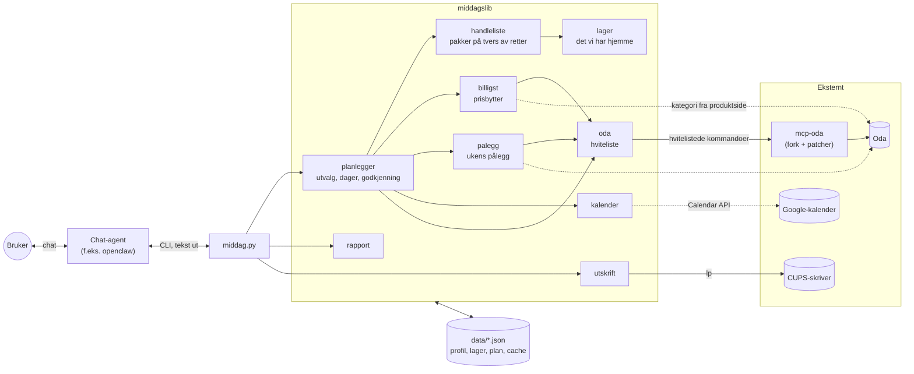
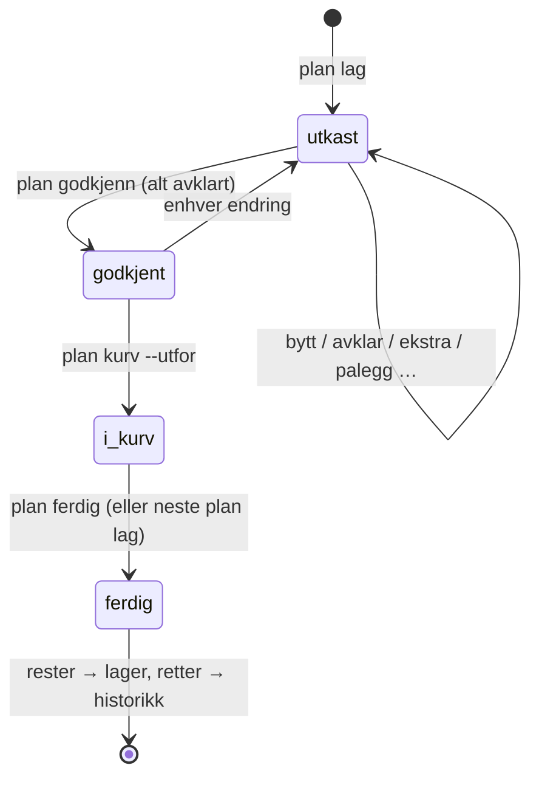

# Middagsplanlegger

Planlegger ukens middager for en familie og fyller handlekurven hos Oda. Den
velger retter, regner ut handlelisten på tvers av rettene, trekker fra det som
finnes hjemme, bytter til rimeligste likeverdige vare og legger varene i kurven.
Den er laget for å styres av en AI-agent i en chat, men alt er vanlige
CLI-kommandoer. Python-standardbibliotek, ingen LLM-kall i koden.

**Den bestiller og betaler aldri.** Den legger bare varer i kurven, og du trykker
«bestill» selv i Oda.

## Design



Planen har en tilstand som verktøyet håndhever. Enhver endring etter godkjenning
sender den tilbake til utkast, og godkjenningen er bundet til en hash av planens
innhold.



## Hvorfor det fungerer

- **Handlelisten regnes i pakker, ikke per oppskrift.** Oda oppgir hvor stor
  andel av en pakke hver porsjon bruker. Andelene summeres per vare for hele
  uken og rundes opp én gang. To retter med 2 dl og 1 dl fløte gir én kartong.
- **Rettene velges mot hele uken.** Utvalget er grådig. Hver kandidat får en
  kostnad: ferskvare som blir til overs (kr), pluss en vektet merpris, pluss
  straff for samme hovedingrediens, samme rettstype og retter fra de siste tre
  ukene, og minus bonus for det familien liker. Retter som deler ingredienser,
  vinner derfor naturlig.
- **Prisbytter med strenge regler.** For hver vare søkes det etter rimeligere
  produkter, og kostnaden sammenlignes for ukens faktiske behov i hele pakker.
  Et bytte krever samme hovedord, ingen annen variant (røkt, laktosefri …), ingen
  ferdigmat og samme hovedkategori hos Oda. Kategorien leses fra produktsiden og
  caches.
- **Lageret er en del av beregningen.** Varer hjemme trekkes fra i mengde der den
  er kjent. Usikre treff, basisvarer og små andeler gir et spørsmål i stedet for
  et kjøp. Når uken avsluttes, trekkes forbruket fra og restene legges inn.
- **Dagene fordeles etter holdbarhet og aktiviteter.** Retter med fisk, kjøttdeig
  og urter kommer først etter levering. Aktivitetsdager får frossen ferdigmiddag,
  rest fra en dobbel porsjon eller en rask rett.
- **Minstebeløpet håndteres.** Er kurven under Odas grense, legges frysbare
  ekstra middager til. Summen bruker beløpet etter mengderabatter.
- **Sikkerhet i koden, ikke bare i instruksen.** `oda.py` slipper bare gjennom
  hvitelistede mcp-oda-kommandoer: ingen bestilling, betaling, tømming, sletting
  eller leveringstid. Kurven fylles bare fra en godkjent plan, og det som
  allerede er lagt til, hoppes over ved en ny kjøring. Innlogging bekreftes før
  kurven røres, så varene ikke havner i en anonym gjestekurv.

## Integrasjoner

| Integrasjon | Hvordan | Valgfri |
|---|---|---|
| **Oda** | [mcp-oda](https://github.com/agfagerbakk/mcp-oda), låst til en commit, med egne patcher for ingredienser med produkt-ID og kurvbeløp etter rabatt. Kjøres med Node eller i container | nei |
| **Google-kalender** | Hendelser i ukens primærkalender med et av søkeordene i tittel eller beskrivelse gjør dagen til aktivitetsdag | ja |
| **Chat-agent** | Agenten kjører CLI-et og sender teksten videre. [AGENT.md](AGENT.md) er instruksen | ja |
| **WhatsApp via openclaw** | `lager sjekk --send` sender den ukentlige lagersjekken | ja |
| **Skriver (CUPS)** | `skriv-ut` lager A4-PDF av dagens oppskrift og sender den med `lp`, typisk fra cron | ja |

Kalenderen slås på slik:

```bash
python3 middag.py profil sett kalender ja
python3 middag.py profil sett kalender_sokeord "fotball,svømming,turn"
```

Den trenger et `gcalendar.py` med `get_creds()` i `MIDDAG_GCALENDAR_DIR` og
`google-api-python-client`. Feiler oppslaget, brukes de faste aktivitetsdagene,
og planen lages likevel.

## Tilpasninger

Alt lagres i `data/profil.json` og endres med kommandoer (eller av agenten når du
sier det i chatten).

| Hva | Kommando |
|---|---|
| Familiemedlemmer og alder (porsjoner regnes ut) | `profil medlem-legg-til barn 4`, `profil medlem-alder 3 7`, eller `profil sett porsjoner 5` |
| Allergier (alvorlige) og ting dere ikke vil ha | `profil legg-til allergier nøtter`, `profil legg-til unngaa sopp` |
| Det dere liker (søkes først, gir bonus) | `profil legg-til liker taco` |
| Middagsdager og faste aktivitetsdager | `profil sett middagsdager man,tir,ons,tor,fre`, `profil sett aktivitetsdager tir,tor` |
| Maks tid, vanlig dag og aktivitetsdag | `profil sett maks_tid_min 40`, `profil sett maks_tid_aktivitetsdag_min 20` |
| Basisvarer dere alltid har | `profil legg-til alltid_hjemme soyasaus` |
| **Faste ukevarer** (bleier, melk, brød …) | `profil fast-vare <produkt-id> [antall] --navn "…" --pris 31.9` |
| **Pålegg:** faste typer, antall tilfeldige, pristak | `palegg faste gulost,brunost,syltetoy`, `palegg antall 3`, `palegg maks-pris 80` |
| **Svarteliste** for pålegg | `palegg svarteliste <produkt-id>` eller `palegg svarteliste makrell` |
| Egne oppskrifter | `egen "Fredagstaco" --ingrediens "Kjøttdeig=12345:1" …` |
| Sparemodus som standard | `profil sett sparemodus ja` |
| Minstebeløp og maks ekstra middager | `profil sett min_bestilling_kr 1300`, `profil sett maks_ekstra_middager 2` |
| Skriver | `profil sett skriver <CUPS-kø>` |

Den som bare vil endre noe én uke, bruker plan-kommandoene: `plan bytt`,
`plan fri`, `plan ekstra`, `plan erstatt`, `plan original`, `plan palegg-bytt`.

## Flyt

```
plan lag  →  plan vis  →  (avklar / bytt / dobbel / fri)  →  plan godkjenn  →  plan kurv --utfor
                                                         viser «før»            viser «etter»
```

1. `plan lag` velger retter for neste uke. Den tar hensyn til familieprofilen,
   allergier, aktivitetsdager, lageret og hva dere har spist de siste tre ukene.
   Forrige ukes plan avsluttes automatisk først (se [Lageret](#lageret)).
2. Ukens ingredienser slås sammen for alle retter samlet. Oda oppgir hvor mange
   *pakker* hver porsjon trenger. Brøkdelene summeres per vare før vi runder opp.
   Er det usikkert om noe finnes hjemme, spør den i stedet for å gjette.
3. Utvalget skjer én rett om gangen. Hver ny rett vurderes etter hva den gjør med
   hele ukens handleliste: ekstra kostnad, ferskvare som blir til overs, og
   variasjon.
4. Frysbare retter (gryter, supper, lasagne …) lages i dobbel porsjon en vanlig
   dag, og resten spises på en aktivitetsdag. Er det 1–2 dager mellom, holder
   kjøleskapet. Ellers fryses resten. Ligger aktivitetsdagen først i uken, fryses
   dobbelporsjonen til samme dag uken etter. Ferdigmiddager som allerede ligger i
   fryseren, brukes først.
5. For hver vare søker den etter rimeligste likeverdige produkt
   (se [Prisbytter](#prisbytter)).
6. Faste ukevarer legges til, og fryse-middager legges til ved behov for å nå
   Odas minstebeløp (se [Faste varer og minstebeløp](#faste-varer-og-minstebeløp)).
7. Ingenting legges i kurven før planen er godkjent. Endrer du planen etter
   godkjenning, må den godkjennes på nytt. Samme plan kan ikke legges i kurven to
   ganger.

## Sikkerhet

Verktøyet er logget inn på en ekte Oda-konto og styres av en AI-agent. Det er
bygd for at feil skal være ufarlige, men kontoen bør også settes opp så lite kan
gå galt.

### Anbefalt oppsett av Oda-kontoen

- **Slett alle lagrede betalingskort i Oda** og betal med
  Vipps når du bestiller. Da finnes det ikke noe betalingsmiddel på kontoen.
  Selv om noe skulle klare å trykke «bestill», blir det ingen betaling uten at
  du godkjenner den i Vipps på telefonen.
- **Bruk et eget, sterkt passord for Oda** som ikke brukes andre steder.
  Passordet ligger på maskinen verktøyet kjører på.
- **Se gjennom kurven før du bestiller.** Planen er laget for å være riktig, men
  du er siste kontroll. Er noe feil, rett det i chatten (for eksempel
  `plan erstatt`) eller direkte i Oda.

### Innebygd i verktøyet

- **Aldri bestilling.** mcp-oda har ingen bestill- eller betal-kommando. I tillegg
  sperrer `middagslib/oda.py` alt som ikke står på en hviteliste: tømme kurven,
  fjerne varer, velge leveringstid, slette lister og legge hele oppskrifter i
  kurven forbi lagersjekken. Dette er dekket av tester.
- **Godkjenning før kurven.** `plan kurv --utfor` virker bare på en godkjent plan,
  og godkjenningen er bundet til en hash av planens innhold. Enhver endring krever
  ny godkjenning. Det som allerede er lagt i kurven, legges ikke til på nytt.
- **Innlogging.** E-post og passord ligger i `~/.config/middag/oda.env` med
  rettighet 600, utenfor repoet. Programmet nekter å lese filen hvis andre kan
  lese den. Passordet sendes til mcp-oda via stdin (`--pass-stdin`), aldri som
  argument, så det vises ikke i `ps`.
- **Ikke gjestekurv.** Uten innlogging gir Oda en anonym kurv. Derfor bekreftes
  innloggingen før kurven leses eller endres.
- **Private data.** Alt `middag.py` lager i `data/` (familie, allergier, lager,
  planer, PDF-er), lages med umask 077, så bare eieren kan lese det. `data/` og
  `*.env` er holdt utenfor git. Logger som cron skriver med `>>`, lages av skallet:
  sett `umask 077` i crontab eller `chmod 600` på dem.
- **Låst avhengighet.** mcp-oda er låst til en bestemt commit og bygges med
  `npm ci` fra lockfilen. En oppdatering fra upstream kommer bare når du endrer
  `PIN` selv. Les gjennom endringene før du gjør det.
- **Kategorioppslag uten innlogging.** Produktkategorier hentes fra Odas
  offentlige produktsider med en vanlig GET, uten cookies eller innlogging.

### Det du må passe på selv

- **Sesjonen er like mye verdt som passordet.** Innloggingen (cookies) ligger i
  `~/.mcp-oda/`. Den som har filene, er logget inn på kontoen din og ser
  leveringsadresse og ordrehistorikk. mcp-oda skriver `cookies.json` med
  rettighet 600, men selve mappen kan bli lesbar for andre. Sett
  `chmod 700 ~/.mcp-oda` (`scripts/oda-podman.sh` gjør det automatisk).
- **Agenten har skalltilgang.** Hviteliste og godkjenning gjelder når agenten
  går gjennom `middag.py`. En agent med fri skalltilgang kan i prinsippet kjøre
  mcp-oda direkte eller endre koden. Kjør agenten som en egen bruker uten sudo,
  og la bare deg selv og husstanden snakke med den. I openclaw gjøres det med
  en hviteliste over telefonnumre.
- **Prompt injection.** Agenten leser tekst den ikke kontrollerer: oppskrifter,
  produktnavn, bilder og meldinger. [AGENT.md](AGENT.md) sier at den aldri skal
  bestille og alltid spørre før kurven fylles. Det er likevel instruksen til en
  språkmodell, så det er sperrene i koden og en Oda-konto uten lagret kort som
  er den egentlige beskyttelsen.
- **Sikkerhetskopier.** `data/`, `oda.env` og `~/.mcp-oda/` inneholder
  personopplysninger og innlogging. Krypter sikkerhetskopier som inneholder dem,
  eller hold `oda.env` og `~/.mcp-oda/` utenfor.
- **Avslutt tilgangen** ved å slette `~/.config/middag/oda.env` og `~/.mcp-oda/`.
  Bytt også passordet hos Oda hvis maskinen kan være kompromittert.

## Plattformer

| Plattform | Status |
|---|---|
| Linux, x86_64 og arm64 (Debian, Ubuntu, Fedora, Raspberry Pi OS 64-bit …) | Støttet. Testet på Debian 13 på Raspberry Pi (arm64) og en Fedora-basert desktop |
| Immutable Linux (Fedora Silverblue o.l.) eller maskin uten Node | Støttet. mcp-oda kjøres i en container, se [Maskin uten Node](#maskin-uten-node) |
| macOS | Bør virke (Python og Node fra Homebrew, utskrift via innebygd CUPS), men er ikke testet |
| Windows | Ikke direkte: skriptene er bash, og passordfilen sjekkes med Unix-rettigheter. Bruk WSL 2 (Ubuntu), da gjelder Linux-raden |

Krav:

- **Python 3.10+.** Bare standardbiblioteket, bortsett fra `reportlab` for
  PDF-utskrift (valgfritt, se [Utskrift](#utskrift)).
- **Node 18+ og npm** for å bygge og kjøre mcp-oda, *eller* podman/Docker.
- **git** for å hente mcp-oda.
- **CUPS** (`lp`) bare hvis oppskrifter skal skrives ut.
- **En Oda-konto.** Oda leverer i deler av Norge, og verktøyet bruker den
  norske nettbutikken (oda.com/no).

Skal en chat-agent bruke verktøyet, må agenten kunne kjøre skallkommandoer på
samme maskin. En liten, alltid påslått maskin som en Raspberry Pi passer godt.

## Oppsett

### Installasjon

```bash
git clone https://github.com/mrfoyl/middagsplanlegger.git
cd middagsplanlegger
scripts/setup_oda.sh          # kloner mcp-oda, legger på patchene, bygger
scripts/sett_oda_passord.sh   # spør om e-post/passord, skriver oda.env (600)
python3 middag.py oda login   # tester innloggingen
python3 tests/test_middag.py  # alle tester, uten nettverk
```

Oppdatering: `git pull` og deretter `scripts/setup_oda.sh`. Skriptet legger også
på nye patcher på en eksisterende installasjon.

Første gang lages `data/profil.json` med en standardfamilie (to voksne og to
barn). Tilpass den med `profil …`-kommandoene, se [AGENT.md](AGENT.md#familieprofil).

Personlige data ligger i `data/` (profil, lager, plan, historikk, cache, PDF-er) og
er holdt utenfor git. Kopier mappen med hvis du flytter mellom maskiner.

### Agent

Agenten må vite om verktøyet. Legg en kort henvisning i agentens egen
instruksfil (i openclaw: `AGENTS.md` i workspace, under «Tools»), for eksempel:

```markdown
### Middagsplanlegger (Oda)
Middagsplan, lager og Oda-handlekurv: `python3 <sti>/middagsplanlegger/middag.py`.
Les `middagsplanlegger/AGENT.md` før du bruker den.
```

### Maskin uten Node

Finnes ikke `node`, kjører `middagslib/oda.py` mcp-oda i en `node:24-slim`-container
via `scripts/oda-podman.sh` (podman, ellers Docker). Sesjonen lagres fortsatt i
`~/.mcp-oda`. Fra innsiden av en flatpak (for eksempel VS Code) brukes
`flatpak-spawn --host podman`. `scripts/setup_oda.sh` trenger likevel npm for
selve byggingen. Bygg en gang i en container eller på en maskin med Node.

### Kalender (valgfritt)

Se [Integrasjoner](#integrasjoner). `gcalendar.py` må gi Google-legitimasjon
med `get_creds()` (openclaw-workspace har et slikt). Sett `MIDDAG_GCALENDAR_DIR`
til mappen der det ligger.

### Cron (valgfritt)

```cron
# Dagens oppskrift på skriveren, hverdager kl. 07
0 7 * * 1-5 cd <sti>/middagsplanlegger && python3 middag.py skriv-ut >> data/utskrift.log 2>&1
# Lagersjekk i chatten (openclaw), søndag kl. 18 før ukeplanen
0 18 * * 0 cd <sti>/middagsplanlegger && python3 middag.py lager sjekk --send >> data/lagersjekk.log 2>&1
```

## Funksjoner

### Avklaringer i chatten

Planen spør (❓) om varer som kanskje finnes hjemme, basisvarer, varer der bare en
liten del av pakken brukes (under 10 %, ikke ferskvare), og faste varer som ligner
noe i lageret. Svarene registreres med `plan avklar <vare> har|kjop`. Planen kan
ikke godkjennes før alt er besvart.

Agenten skal stille disse som **vanlig melding med nummerert liste**, ikke med et
innebygd spørsmålsverktøy. Openclaw sitt spørsmålsverktøy krever ett svar per
linje og at hvert svar matcher et alternativ. Ett ubesvart spørsmål avviser hele
svaret, og brukeren blir sittende fast. Står et slikt spørsmål fast i openclaw,
send `/stop` i chatten. Det avbryter kjøringen, og spørsmålet kanselleres med den.

### Prisbytter

`middagslib/billigst.py` søker etter rimeligste likeverdige produkt for hver vare.
Den sammenligner hva ukens behov koster i hele pakker, ikke bare kilopris. Bytter
skjer bare når:

- hovedordet står først i et ord i produktnavnet («kyllingkjøttboller» er ikke
  «kjøttboller»)
- hovedordet ikke bare er tilbehør («Linsegryte med spinat» er ikke spinat)
- varen ikke er en annen variant (røkt, saus, laktosefri, syltet, sandwich …)
- varen ikke er ferdigmat (gryte, middags-kit, pizza, ravioli, juice …). Det som
  kjøpes, må kunne brukes som råvare i en annen rett
- varen ligger i samme hovedkategori hos Oda som originalen (Frukt og grønt,
  Kylling og kjøtt …). Kategorien leses fra den offentlige produktsiden og caches
  i `data/cache/kategorier.json`. Kan den ikke hentes, byttes det ikke
- kjøttslag og farge ikke endres (storfe → svin og grønne → røde linser avvises)
- ingen allergier eller unngå-ord treffes

Byttene vises i planen og kan angres med `plan original <vare>`. `plan billigst`
kjører prissjekken på nytt.

### Sparemodus

`plan lag --spar` gir spesielt billige middager der varene holder i minst to uker:

- Bare retter der høyst én kortholdbar vare ikke finnes frossen eller kan fryses
  (typisk en urt til pynt). Kylling, kjøttdeig, fisk, pølser og grønnsaker er greit:
  de byttes til frossen variant eller står på «frys ned ved levering».
- Ferske varer byttes til frossen variant når den koster høyst 15 % mer.
- Pris veier over 3 ganger tyngre enn vanlig, og svinn dobbelt. Variasjonsstraffene
  skaleres likt, så det ikke blir pannekaker hver dag.
- Holdbarhet vurderes uåpnet: fløte, rømme og sitron regnes som 3 uker, revet ost
  og tortilla som 4. Svinnberegningen bruker fortsatt kortere tall for åpnede rester.
- Planen viser kr per porsjon, hva som bør fryses ved levering, og hva som ikke
  holder to uker.

Sparemodus som standard: `profil sett sparemodus ja` (overstyr med `plan lag --vanlig`).
Planen dekker fortsatt én uke av gangen.

### Faste varer og minstebeløp

- **Faste ukevarer** (bleier, brød, melk …) legges inn med
  `profil fast-vare <produkt-id> [antall] --navn "…" --pris 75.4` og havner i hver
  plan. Ligner en av dem noe i lageret, blir den et spørsmål. «Har» tar den ut av
  ukens handel, og en uavklart fast vare legges aldri i kurven.
- **Minstebeløp:** Er handelen under `min_bestilling_kr` (standard 1300), legges
  frysbare ekstra middager til. Det blir høyst `maks_ekstra_middager` (standard 2),
  fordelt på ulike dager. Hver får en lagedag, og oppskriften skrives ut den dagen.
  Ekstra middager lagres i historikken. Når uken avsluttes, ligger de i fryseren
  med ❓ til du bekrefter med `lager ok <navn>`. Først da brukes de på en
  aktivitetsdag. Varer som planen selv allerede har lagt i kurven, teller ikke
  med i sjekken.
- **Mengderabatter:** Odas kurv-sum (`display_price`) trekker ikke fra
  kampanjer som «2 for 1». Patch `0002` til mcp-oda leser det reelle beløpet per
  linje (`discounted_display_price_total`) og summerer det til
  `discounted_display_price`. `Oda.belop_etter_rabatt()` bruker det beløpet både i
  minstebeløp-sjekken og i kurvvisningen. Odas urabatterte tall vises i parentes
  når de avviker.

### Pålegg

`middagslib/palegg.py` velger ukens pålegg. Hver uke kommer de faste typene
(standard gulost og brunost) pluss tre tilfeldige typer fra resten: smøreost,
kjøtt- og kyllingpålegg, spekemat, leverpostei, salatpålegg, fiskepålegg,
tubepålegg, syltetøy, søtpålegg og honning. Typer fra forrige uke velges sist.

Innenfor hver type søker velgeren hos Oda og sorterer på kr/kg. Kiloprisen
regnes ut fra pris og vekt, fordi Odas egen av og til er feil. Kategorien
bekreftes på produktsiden (Pålegg › Spekemat og salami osv.), og pakker over
`maks_pris` (standard 80 kr, gulost 130 kr) hoppes over. Velgeren tar en
tilfeldig vare blant de fire rimeligste og unngår forrige ukes vare. Valget er
fast per uke, så samme uke gir samme pålegg om igjen.

| Kommando | Hva |
|---|---|
| `palegg vis` | innstillinger og svarteliste |
| `palegg faste gulost,brunost` | typer som kommer hver uke |
| `palegg antall 3` | antall tilfeldige typer i tillegg |
| `palegg maks-pris 80` | høyeste pris per pakke |
| `palegg svarteliste <produkt-id\|ord>` | aldri dette produktet / ingenting med ordet. Bytter det også ut i en plan som ikke er i kurven ennå |
| `palegg fjern-svarteliste <produkt-id\|ord>` | angre |
| `plan palegg` | velg ukens pålegg på nytt |
| `plan palegg-bytt <type\|produkt-id\|ord>` | en annen vare av samme type |

Pålegget ligger i planens `ekstra` (merket `palegg`), teller mot minstebeløpet og
legges i kurven sammen med de faste varene. Historikken ligger i
`data/palegg_historikk.json`.

### Utskrift

`python3 middag.py skriv-ut` skriver ut dagens oppskrift som en A4-PDF. Arket har
ingredienser regnet om til porsjonene som skal lages, fremgangsmåten,
produktbytter og påminnelser som «lag dobbel» og «ta ut fra fryseren i kveld».
Er det en ekstra fryse-middag samme dag, skrives den ut i tillegg. Utskriften går
via CUPS (`lp`) til skriveren i profilen, eller systemets standardskriver hvis
ingen er satt. Velg kø med `profil sett skriver <kø>` (`lpstat -p` viser køene).
Hver dag skrives bare ut én gang.
Restedager og ferdigmiddager hoppes over.

Krever `reportlab` (`apt install python3-reportlab` eller `pip install
reportlab`). Uten den skrives en ren tekstversjon ut. Annen dag eller manuelt: `skriv-ut --dag fre`, `--igjen`, eller `--bare-fil`
for bare å lage PDF-en.

### Lageret

- **Innlegging:** `lager legg-til "melk=1 l" "løk"`, eller agenten leser et bilde av
  kjøleskapet. Middager i fryseren: `lager legg-til kjøttsaus --fryst-middag 4`.
- **Forbruk:** Når uken avsluttes (`plan ferdig`, kjøres automatisk av neste
  `plan lag`), trekkes det rettene brukte fra lageret. Varer med kjent mengde
  reduseres, og varer uten mengde merkes ❓ «sjekk om noe er igjen». Rester av det
  som ble kjøpt, legges inn.
- **Gammel ferskvare:** Ferskvare som har passert holdbarheten, gir et spørsmål i
  planen. Har den ligget dobbelt så lenge, fjernes den automatisk ved `plan lag`
  og `lager rydd`. Tørrvarer, krydder og fryste middager fjernes aldri automatisk.
- **Ukentlig sjekk:** `lager sjekk` lager en liste over ferskvare som har passert
  holdbarheten og varer merket ❓. Svarene registreres med `lager ok <vare>`
  (finnes fortsatt, ny dato) eller `lager fjern <vare>`. Med `--send` sendes
  listen på WhatsApp via `openclaw message send`. Det krever openclaw og
  `profil sett whatsapp <nummer>`. Uten openclaw kan cron i stedet skrive
  `lager sjekk` til en fil som agenten leser.

## Miljøvariabler

| Variabel | Standard | Brukes til |
|---|---|---|
| `MIDDAG_DATA` | `./data` | profil, lager, plan, historikk, cache |
| `MIDDAG_CREDENTIALS` | `~/.config/middag/oda.env` | Oda-innlogging |
| `MIDDAG_ODA_CMD` | `node vendor/mcp-oda/dist/index.js`, ellers `scripts/oda-podman.sh` | kjøre mcp-oda på annen måte |
| `MIDDAG_ODA_DATA` | (mcp-oda: `~/.mcp-oda`) | sesjonskatalog |
| `MIDDAG_GCALENDAR_DIR` | `~/.openclaw/workspace` | hvor `gcalendar.py` ligger |
| `MIDDAG_OPENCLAW` | `openclaw` i PATH, ellers `~/.npm-global/bin/openclaw` | `lager sjekk --send` (WhatsApp via openclaw) |

## Fork av mcp-oda

`vendor/mcp-oda` er en lokal fork av
[agfagerbakk/mcp-oda](https://github.com/agfagerbakk/mcp-oda), låst til commit
`62f0b64`, med patchene i `patches/`:

- **0001** `recipe ingredients <id>`, også tilgjengelig som MCP-verktøyet
  `recipes_get_ingredients`. Den gir produkt-ID, pakker per porsjon og
  basisvare-flagg for hver ingrediens. `recipe details` gir bare fritekst, og
  det er ikke nok til å slå sammen varer på tvers av retter.
- **0002** Kurven (`cart list`) eksponerer også det reelle beløpet etter
  mengderabatter (`discounted_display_price` på kurven, `discounted_line_total`
  per vare).

`scripts/setup_oda.sh` gjenskaper forken fra upstream og legger på patcher som
mangler. En patch regnes som lagt på hvis den kan reverseres rent. Slik oppdaterer
du upstream: endre `PIN`, slett `vendor/`, kjør skriptet på nytt og løs eventuelle
konflikter.

## Struktur

```
middag.py               CLI
middagslib/
  oda.py                hviteliste over mcp-oda, innlogging, kurvbeløp etter rabatt
  oppskrifter.py        Oda-oppskrifter (cache 14 d) + egne oppskrifter
  handleliste.py        sammenslåing på tvers av retter, lager, svinn
  planlegger.py         utvalg, dagfordeling, minstebeløp, godkjenning, kurv
  billigst.py           rimeligste likeverdige produkt, frosne varianter i sparemodus
  palegg.py             ukens pålegg: faste + tilfeldige typer, rimelig per kg, svarteliste
  profil.py / lager.py  familieprofil, faste varer, det vi har hjemme
  matvarer.py           holdbarhet, allergener, frysbarhet, sparemodus (nøkkelord)
  enheter.py            «500 g», «3 dl», «4 x 125 g»
  kalender.py           aktivitetsdager fra Google-kalenderen (valgfritt)
  rapport.py            tekst for chat (*fet*, korte linjer)
  utskrift.py           PDF av dagens oppskrift til skriveren
  lagring.py            stier og atomisk JSON-lagring
scripts/
  setup_oda.sh          klon, patch og bygg mcp-oda
  sett_oda_passord.sh   skriv oda.env med rettighet 600
  oda-podman.sh         mcp-oda i container (podman/Docker) når Node mangler
patches/                våre endringer i mcp-oda
tests/                  tester mot ekte Oda-oppskriftsdata i fixtures/
```

## Begrensninger

- Allergenfilteret leter etter nøkkelord, for eksempel «fløte» for melk og
  «pasta» for gluten. Det fanger det vanlige, men er ingen garanti. Har noen en
  alvorlig allergi, må ingredienslisten sjekkes (`oppskrift vis <ref>`).
- Holdbarhet og frysbarhet er grove anslag ut fra navnet. Om en rett tåler
  frysing kan overstyres med `oppskrift frysbar <ref> ja|nei`.
- Lagervarer uten oppgitt mengde regnes som «nok». Varer som bare ligner,
  for eksempel «pasta» mot «fusilli», gir alltid et spørsmål.
- Minstebeløp-sjekken bruker den lagrede listeprisen for faste varer. En «2 for 1»
  på en fast vare synes først når varen ligger i kurven, så planen kan tro den er
  over grensen når den ikke er det. Kurvvisningen etter `plan kurv --utfor` bruker
  det reelle beløpet og varsler.
